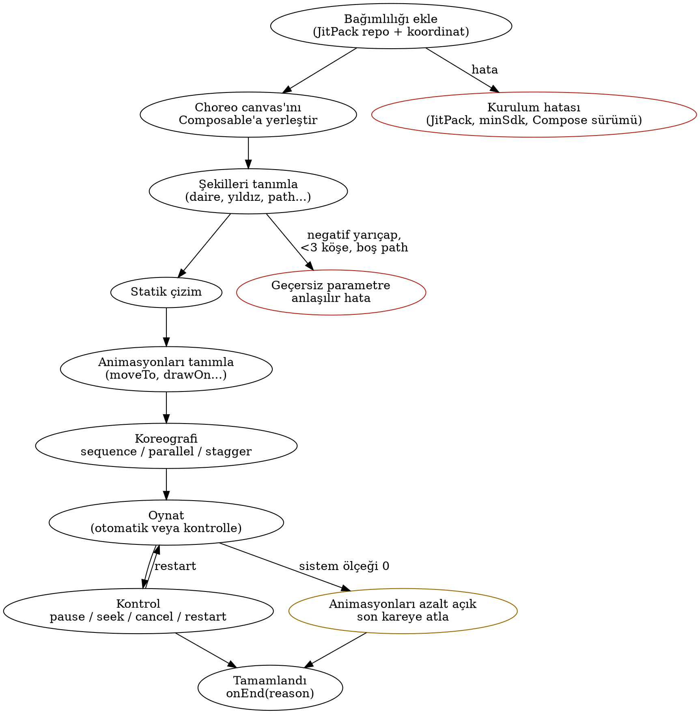
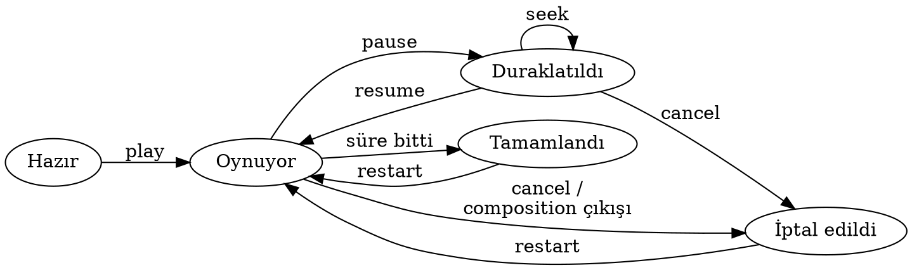

# Choreo İş Analizi (v1) TASLAK

Tarih: 11.11.2026 · Hazırlayan: business-analyst ajanı · Durum: Taslak

## 1. Özet

- **Choreo**, Jetpack Compose Canvas üzerinde şekil çizen ve bu şekilleri tek satırla, şekil düzeyinde animate eden açık kaynak bir Android kütüphanesidir (`io.github.tugakca.choreo`).
- "Kullanıcı", kütüphaneyi projesine ekleyen Android geliştiricisidir; başarı ölçüsü onun "bağımlılığı ekle → ilk animasyonu gör" süresidir.
- Pazarda boşluk gerçek ama dar: Compose'un yerleşik API'leri değer düzeyinde, Lottie/Rive tasarımcı dosyası düzeyinde çalışır; en yakın rakip **Koreography** yalnızca genel `Animatable` değerlerini koreografe eder, şekil çizmez ve "early preview" durumundadır.
- Choreo'yu ince bir sarmalayıcıdan ayıracak üç şey önerilir: **kontrol edilebilir zaman çizelgesi** (oynat/duraklat/iptal/başa sar/seek), **drawOn** gibi Compose'da hazır olmayan şekil efektleri ve **erişilebilirliğe varsayılan uyum** (animasyonları azalt).
- Taslak kapsam büyük ölçüde doğru; eksikler yaşam döngüsü/kesinti kuralları, erişilebilirlik, API kararlılığı, test ve dokümantasyon tarafında.
- Kritik bulgu: çok modüllü repoda JitPack koordinatı `com.github.tugakca:choreo:v0.1.0` değil, **`com.github.tugakca.choreo:choreo:v0.1.0`** olur (K2).
- Lisans önerisi **Apache 2.0**; tüm olası bağımlılıklar (AndroidX, Kotlin) Apache 2.0 olduğundan uyum sorunu yok.
- Tugrul'un onayına 14 revizyon önerisi ve 8 açık soru sunuluyor (bölüm 7-8).

## 2. Amaç ve kapsam

**Amaç:** Compose geliştiricisinin "bir şekli çiz, şu sırayla hareket ettir, sonra şunlar birlikte solsun" fikrini `Canvas` + `Animatable` + `PathMeasure` + coroutine kodu yazmadan, okunur bir DSL ile ifade etmesini sağlamak.

**Değer:** Daha az kod, okunur koreografi, test edilebilir zaman çizelgesi, erişilebilirlik varsayılanları. İkincil değer: Tugrul için Senior Android portfolyosu (API tasarımı, kütüphane yayıncılığı, CI, ABI disiplini).

**Rakip ve alternatif konumlandırma**

| Alternatif | Ne yapar | Choreo'ya göre boşluk |
|---|---|---|
| Compose yerleşik API'leri (`Animatable`, `animate*AsState`, `Transition`, `InfiniteTransition`, `keyframes`) [K5] | Değer düzeyinde animasyon; sıralama coroutine ile elle yazılır | Şekil modeli yok, sequence/parallel için boilerplate, path "çizilme" efekti hazır değil |
| androidx.graphics:graphics-shapes 1.1.0 (`RoundedPolygon`, `star`, `Morph`) [K6] | Geometri üretir, morph hesaplar | Animasyon/koreografi katmanı yok; Choreo için **rakip değil, yapı taşı** |
| Lottie (Apache 2.0) [K7] | After Effects'ten gelen JSON'u oynatır | Tasarımcı aracı gerekir, kodla üretilen dinamik şekiller için uygun değil |
| Rive (runtime MIT) [K8] | Editör + durum makinesi runtime'ı | Ayrı araç ve dosya formatı; native runtime boyutu; kod-öncelikli değil |
| Koreography (Apache 2.0, ~218 yıldız) [K9] | `Animatable` hareketlerini sequence/parallel DSL ile dizer | Şekil çizmez, seek/pause yok, "early preview"; en yakın fikir rakibi |
| animate-compose, Orbital, material-motion-compose [K10] | Hazır UI efektleri, geçişler | Canvas şekli ve koreografi odaklı değil |

**Kapsam içi (Faz 1, revizyonlar onaylanırsa):** şekiller, stil, 6 animasyon tipi, süre/easing/gecikme/tekrar, `sequence`/`parallel`/`stagger`, kontrol nesnesi, erişilebilirlik varsayılanları, `:choreo` + `:sample`, CI, JitPack, README.

**Kapsam dışı (Faz 1):** morph, dokunma/sürükleme, gradient, keyframe timeline editörü, View desteği, Maven Central, Compose Multiplatform, ses senkronu, SVG dosyası içe aktarma (path-data string hariç, bkz. P8).

## 3. Kullanıcılar ve hedefleri

| Kullanıcı | Hedefi | Beklentisi |
|---|---|---|
| Uygulama geliştiricisi (birincil) | Onboarding, boş durum, yükleme, başarı animasyonunu hızla yapmak | 5 dakikada kurulum, IDE'de keşfedilebilir API, Compose'a "yerli" his |
| Tasarım odaklı geliştirici | Logo/illüstrasyon animasyonu, çizilme efekti | Easing ve zamanlama üzerinde ince kontrol, önizleme |
| Kütüphane katkıcısı | Hata düzeltme, yeni şekil/animasyon | Okunur kod, CONTRIBUTING, testler, yeşil CI |
| Tugrul (bakımcı) | Hızlı Faz 1 yayını, sonra büyütme, portfolyo | Kırılmayan API, otomatik yayın, düşük bakım yükü |
| Son kullanıcı (dolaylı) | Akıcı ve rahatsız etmeyen hareket | "Animasyonları azalt" ayarına uyum, jank olmaması |

## 4. İş akışları

**Ana akış: geliştiricinin bakış açısı**

**Adımlar ve mutsuz yollar**

1. **Bağımlılığı ekleme.** `settings.gradle.kts` içine `maven("https://jitpack.io")`, modüle `com.github.tugakca.choreo:choreo:<tag>`.
    - JitPack ilk istekte derler; ilk kurulum dakikalar sürebilir veya derleme hatası verebilir. Tag atılınca CI'ın JitPack'i "ısıtması" gerekir (G29).
    - Tüketicinin minSdk'sı veya Compose sürümü Choreo'nunkinden düşükse manifest/sürüm çakışması olur; README'de uyumluluk tablosu şart (G03).
2. **Canvas'ı yerleştirme.** Boyut 0 ise hiçbir şey çizilmez; debug'da uyarı logu önerilir.
3. **Şekil tanımlama.** Geçersiz değerler (negatif yarıçap, 3'ten az köşe, boş path) sessizce yutulmaz, açık mesajlı `IllegalArgumentException` verilir (G05).
4. **Statik çizim.** Tanım sırası çizim sırasıdır (z-order); stil dolgu/kontur/ikisi.
5. **Animasyon tanımlama.** Her animasyon süre, easing, gecikme, tekrar alır. Süre 0 veya negatifse anında son değer ya da hata (açık soru S6).
6. **Koreografi.** `sequence {}`, `parallel {}`, iç içe kullanım, `stagger`. Aynı özelliğe çakışan iki animasyon gelirse kural tanımlı olmalı: son gelen kazanır, mevcut değerden devam eder, sıçrama olmaz (G13).
7. **Oynatma.** Otomatik başlatma veya kontrol nesnesiyle başlatma. Sistem "animasyonları azalt" açıksa (animator duration scale = 0) son kareye atlanır; sonsuz döngüde statik bir kare gösterilir (G19).
8. **Kontrol.** pause/resume/cancel/restart/seek; ilerleme ve durum gözlemlenebilir.
9. **Tamamlanma.** `onEnd(reason)` = tamamlandı / iptal edildi; iptalde "tamamlandı" sanılmaması için neden ayrımı gerekir.
10. **Yaşam döngüsü.**
    - Recomposition animasyonu sıfırlamaz; yalnızca belirtilen anahtar değişince yeniden kurulur (G16).
    - Uygulama arka plana gidince kare saati durur, dönünce kaldığı yerden sürer (G18).
    - Ekran döndürme: varsayılan davranış açık soru (S5).
    - Composable composition'dan çıkınca tüm işler iptal edilir, sızıntı olmaz (G15).

**Koreografi durum yaşam döngüsü**

## 5. Gereklilikler

| ID | Gereklilik | Öncelik | Kaynak |
|---|---|---|---|
| G01 | JitPack'ten tag ile kurulabilir; README'de doğru çok modüllü koordinat | Must | Brief, K2 |
| G02 | Saf Compose; çalışma zamanı bağımlılığı yalnız AndroidX Compose (+ P3 onaylanırsa graphics-shapes) | Must | Brief |
| G03 | minSdk, compileSdk, Kotlin ve Compose BOM sürümleri README'de tablo olarak | Must | K11 |
| G04 | Şekiller: daire, dikdörtgen, yuvarlak köşeli dikdörtgen, çizgi, düzenli çokgen, yıldız, özel `Path` | Must | Brief |
| G05 | Geçersiz şekil/animasyon parametresinde açık mesajlı hata | Must | Analiz |
| G06 | Stil: dolgu/kontur/ikisi, renk, kontur kalınlığı, alpha; kontur cap/join | Must / Should | Brief, P9 |
| G07 | Dönüşüm: konum, ölçek, dönme (pivot varsayılanı şekil merkezi), alpha; z-order = tanım sırası | Must | Analiz |
| G08 | Animasyonlar: moveTo, scaleTo, rotateTo, fadeTo, colorTo, drawOn | Must | Brief |
| G09 | Her animasyonda süre, easing (Compose `Easing`), gecikme, tekrar (n / sonsuz) | Must | Brief |
| G10 | `sequence {}` ve `parallel {}`, iç içe kullanılabilir | Must | Brief |
| G11 | `stagger(delay)`: aynı animasyonu şekil grubuna kaydırarak uygulama | Should | P5 |
| G12 | Tekrar modu: baştan / ters (yoyo) | Should | P6 |
| G13 | Kesinti kuralı: aynı özelliğe yeni animasyon mevcut değerden devam eder, sıçrama yok | Must | P7 |
| G14 | Kontrol nesnesi: play, pause, resume, cancel, restart, seek(0..1); durum ve ilerleme gözlemlenebilir; `onEnd(reason)` | Must | P1 |
| G15 | Composition'dan çıkışta tüm animasyonlar iptal, sızıntı yok | Must | Analiz |
| G16 | Recomposition animasyonu sıfırlamaz; yeniden kurulum yalnız anahtar değişince | Must | Analiz |
| G17 | Ekran döndürmede davranış tanımlı ve belgelenmiş | Should | S5 |
| G18 | Arka planda kare saati durur, dönüşte kaldığı yerden devam | Must | Analiz |
| G19 | Sistem animasyon ölçeğine uyum; 0 iken son kare, sonsuz döngüde statik kare | Must | K3, K12 |
| G20 | Geliştirici için "reduced motion" politikası: sisteme uy (varsayılan) / son kareye atla / yok say | Should | P10 |
| G21 | Canvas'a `contentDescription` / semantics verilebilir; dekoratifse gizlenebilir | Must | K13 |
| G22 | README'de yanıp sönme ve 5 sn üstü otomatik hareket uyarısı (duraklatma imkanı G14 ile) | Should | K12, K14 |
| G23 | Animasyon kareleri recomposition tetiklemez, yalnız çizim fazında çalışır; sample'da 50 şekil paralel animasyonda gözle görülür jank yok | Should | P11 |
| G24 | `explicitApi()`; tüm public API'de KDoc | Must | Brief |
| G25 | ABI dökümü ve CI'da ABI kontrolü (KGP `abiValidation` veya BCV eklentisi) | Should | K4, P12 |
| G26 | Deneysel API'ler `@ExperimentalChoreoApi` opt-in ile işaretli | Should | P12 |
| G27 | SemVer 0.x; CHANGELOG; GitHub Release notları | Must | P12 |
| G28 | Zaman çizelgesi hesabı için JVM birim testleri; Compose UI testleri `mainClock` ile | Must | P13 |
| G29 | GitHub Actions: PR'da build + test + lint + ABI kontrol; tag'de JitPack derlemesini tetikleyip doğrulama | Must | Brief, K2 |
| G30 | Ekran görüntüsü (screenshot) testleri | Could | P13 |
| G31 | README: kurulum, 30 sn hızlı başlangıç, GIF'ler, API özeti, uyumluluk tablosu, lisans | Must | P14 |
| G32 | Sample: galeri (her animasyon), koreografi demoları, playground (süre/easing kaydırıcıları), reduced motion demosu | Must | P14 |
| G33 | Dokka ile API sitesi (GitHub Pages) | Could | P14 |
| G34 | Apache 2.0 LICENSE, kaynak dosya başlıkları | Must | K15 |
| G35 | Kütüphane veri toplamaz, izin istemez, ağ kullanmaz; README'de beyan | Must | K16 |
| G36 | Üçüncü taraf bağımlılıklar ve lisansları README'de listeli | Should | K15 |

## 6. Regülasyon ve kısıtlar

| Kural | Bizden istediği | Kaynak |
|---|---|---|
| Apache License 2.0 (öneri) | LICENSE dosyası, telif satırı; dağıtımda lisans ve varsa NOTICE korunur; patent lisansı içerir | K15 |
| Bağımlılık lisansları | AndroidX Compose, graphics-shapes, Kotlin stdlib: hepsi Apache 2.0, uyumlu; GPL bağımlılık eklenmemeli | K6, K15 |
| GitHub Terms of Service D.5 | Public repoda kullanıcılar GitHub üzerinden görüntüleme/fork hakkı alır; asıl kullanım hakkı LICENSE ile verilir, bu yüzden LICENSE ilk commit'te olmalı | K17 |
| JitPack | `maven-publish` + publication; AGP 8+ için `jitpack.yml` ile JDK 17+; çok modülde grup `com.github.User.Repo`; tüm modüller yayınlanır, sample yayın dışı tutulmalı | K1, K2 |
| Maven Central (Faz 2) | OSSRH 30.06.2025'te kapandı, Central Portal kullanılır; `io.github.tugakca` namespace'i GitHub ile doğrulanır; imza, sources ve javadoc jar zorunlu | K18 |
| Compose 1.12 (BOM 2026.08.00) | compileSdk 37 ve AGP 9.1.1+ ister; tüketiciye dayatılan sürümler bilinçli seçilmeli | K11 |
| WCAG 2.2: 2.2.2 Pause, Stop, Hide (A) | 5 sn'den uzun otomatik hareket durdurulabilmeli: kütüphane pause/cancel sağlar, sample doğru kullanımı gösterir | K12 |
| WCAG 2.2: 2.3.1 Üç parlama (A), 2.3.3 Etkileşimden animasyon (AAA) | Hızlı yanıp sönen ön ayar sunulmaz; hareket kapatılabilir olmalı | K14 |
| WCAG 2.2: 1.1.1 Metin dışı içerik (A) | Anlamlı çizimler için metin alternatifi verilebilmeli | K13 |
| Android "animasyonları kaldır" ayarı | Compose `MotionDurationScale` ile sistem ölçeğine uyar; kendi saatimizi kullanırsak bu ölçeği ayrıca uygulamalıyız | K3 |
| European Accessibility Act | Kütüphaneye doğrudan değil, onu kullanan AB'deki ürünlere uygulanır; erişilebilir varsayılanlar tüketicinin uyumunu kolaylaştırır | K19 |
| Google Play Data safety | Uygulama geliştiricisi SDK'ların veri toplamasını beyan eder; Choreo'nun "veri toplamaz" olması ve bunu yazması benimsemeyi kolaylaştırır | K16 |

## 7. Revizyon önerileri

| ID | Öneri | Gerekçe | Etki (kullanıcı / efor / risk) | Tavsiye | Durum |
|---|---|---|---|---|---|
| P1 | **Ekle:** kontrol nesnesi (play/pause/resume/cancel/restart/seek, durum, ilerleme, `onEnd(reason)`) | Koreography'den ve ham API'den asıl farkı yaratır; WCAG 2.2.2 için duraklatma; testte seek | Yüksek / Orta / Düşük | Evet, Faz 1 | Onay bekliyor |
| P2 | **Ekle:** tüm koreografi tek zaman çizelgesinden hesaplanır (deterministik, seek ve ters oynatılabilir) | Seek, test ve performans için şart; sonradan değiştirmek kırıcı olur | Yüksek / Orta / Orta | Evet (gereklilik olarak; teknik tasarım developer'da) | Onay bekliyor |
| P3 | **Değiştir:** çokgen/yıldız geometrisini kendimiz yazmak yerine `graphics-shapes` kullan | Yuvarlatılmış köşeli çokgen/yıldız hazır, Faz 2 morph'u bedavaya yakın gelir; Apache 2.0 | Orta / Azaltır / Düşük (bir bağımlılık daha) | Evet | Onay bekliyor |
| P4 | **Ekle:** `drawOn`'un tersi `eraseOff` ve kısmi çizim aralığı (başlangıç/bitiş oranı) | Aynı altyapıyla neredeyse bedava; "yükleme halkası" gibi yaygın senaryolar | Orta / Düşük / Düşük | Evet | Onay bekliyor |
| P5 | **Ekle:** `stagger {}` | Koreografinin en çok istenen kalıbı; sample'da güçlü görsel | Yüksek / Düşük / Düşük | Evet | Onay bekliyor |
| P6 | **Ekle:** tekrar modu ters (yoyo) | Sonsuz döngülerde sıçramayı önler | Orta / Düşük / Düşük | Evet | Onay bekliyor |
| P7 | **Ekle:** kesinti kuralı (G13) belgelensin ve test edilsin | Tanımsız kalırsa en sık hata kaynağı | Yüksek / Düşük / Düşük | Evet | Onay bekliyor |
| P8 | **Netleştir:** "serbest path" = geliştiricinin verdiği Compose `Path` + SVG path-data string; parmakla çizim Faz 2 dokunma kapsamında | Belirsiz kapsam; path-data string ikon/logo için çok kullanışlı | Orta / Düşük / Düşük | Evet | Onay bekliyor |
| P9 | **Ekle:** kontur cap/join ve dash (kesikli çizgi) | drawOn ile birlikte doğal; Compose'da hazır | Orta / Düşük / Düşük | cap/join evet, dash Could | Onay bekliyor |
| P10 | **Ekle:** reduced motion politikası parametresi (varsayılan: sisteme uy) | Erişilebilirlik varsayılanı + geliştiriciye kontrol; Senior seviyesinde fark edilen detay | Yüksek / Düşük / Düşük | Evet | Onay bekliyor |
| P11 | **Ekle:** performans ölçütü (G23) ve sample'da stres demosu | "Çok şekilde yavaş mı?" sorusuna ölçülebilir cevap | Orta / Orta / Düşük | Evet (Should) | Onay bekliyor |
| P12 | **Ekle:** API kararlılık disiplini: ABI kontrolü, `@ExperimentalChoreoApi`, SemVer 0.x, CHANGELOG | Herkese açık kütüphanede kırıcı değişiklikleri görünür kılar; portfolyo değeri | Orta / Düşük / Düşük | Evet | Onay bekliyor |
| P13 | **Ekle:** test stratejisi (JVM zaman çizelgesi testleri + `mainClock` UI testleri; screenshot Could) | Animasyon kütüphanesinde regresyon gözle yakalanmaz | Orta / Orta / Düşük | Evet | Onay bekliyor |
| P14 | **Faz 2 listesini değiştir:** View desteğini çıkar, yerine **Compose Multiplatform** koy; çekirdeği `android.*` bağımsız tut | 2026'da View talebi düşük; graphics-shapes zaten KMP; KMP portfolyoda daha değerli | Orta / Faz 1'de düşük / Düşük | Evet | Onay bekliyor |

Not (P dışı düzeltme): JitPack koordinatı README'de `com.github.tugakca.choreo:choreo:v0.1.0` olarak yazılmalı; Maven Central'a geçince koordinat `io.github.tugakca:choreo` olur (paket adı değişmez, yalnız tüketicinin Gradle satırı değişir).

## 8. Açık sorular ve riskler

**Tugrul'a sorular**

1. **S1 – minSdk:** Öneri 23 (güncel AndroidX/Compose ekosistemi bu yöne gidiyor). 21 mi, 23 mü, 24 mü?
2. **S2 – Koordinat birimi:** Şekil konumu/boyutu dp mi, piksel mi, canvas'a oranlı (0..1) mı? Öneri: dp varsayılan, oranlı birim opsiyonel.
3. **S3 – API tarzı:** Koreografi Composable içinde DSL ile mi (`Choreo { ... }`), yoksa Composable dışında kurulan bir sahne nesnesiyle mi tanımlansın? Öneri: ikisini birleştiren "remember edilen sahne + Composable" yapısı; nihai karar developer ile.
4. **S4 – Otomatik oynatma:** Varsayılan olarak ilk görünümde otomatik başlasın mı?
5. **S5 – Ekran döndürme:** Animasyon baştan mı başlasın, kaldığı yerden mi devam etsin, son durumda mı kalsın? Öneri: varsayılan kaldığı yerden.
6. **S6 – Süre 0 / geçersiz değer:** Hata mı fırlatsın, anında son değere mi atlasın? Öneri: süre 0 geçerli (anında), negatif hata.
7. **S7 – Faz 1 hedef tarihi** ve v0.1.0 için "minimum yayınlanabilir" alt küme: tüm Must'lar mı, yoksa Should'lar v0.2'ye mi?
8. **S8 – İsim:** "Choreo" Android'in `Choreographer` sınıfı ve Koreography ile karışabilir; arama görünürlüğü düşük olabilir. İsim aynen kalsın mı?

**Varsayımlar**

- Tek bakımcı (Tugrul); katkı kabulü açık ama süreç hafif.
- Hedef Compose sürümü güncel stabil (1.12 / BOM 2026.08.00); eski Compose desteği hedeflenmiyor.
- Kütüphane hiçbir izin, ağ erişimi veya veri toplama içermeyecek.
- Sample uygulama Play Store'a yayınlanmayacak (yayınlanırsa Data safety ve hedef API kuralları ayrıca değerlendirilir).
- Kod yorumları ve README İngilizce olacak (açık kaynak kitlesi için).

**Riskler**

| Risk | Etki | Azaltma |
|---|---|---|
| "İnce sarmalayıcı" algısı | Benimsenme ve portfolyo değeri düşer | P1, P2, P4, P10 ile fark yaratan özellikler; README'de "Compose ile karşılaştırma" bölümü |
| Erken API kararlarının kırılması | Tüketicide derleme hatası | 0.x SemVer, ABI kontrolü, `@Experimental` opt-in |
| JitPack'in derleme kırılganlığı (JDK/AGP sürümü) | Kurulamayan sürüm | `jitpack.yml`, tag'de CI ile doğrulama, Faz 2'de Maven Central |
| Compose 1.12'nin AGP 9.1.1 / compileSdk 37 dayatması | Eski projelerde kullanılamama | Bağımlılık sürümünü bilinçli seçmek, uyumluluk tablosu |
| Kapsam kayması (Faz 2 maddelerinin Faz 1'e sızması) | Yayın gecikir | S7 ile net v0.1.0 alt kümesi |
| Performans (çok şekil, her karede path ölçümü) | Jank | G23 ölçütü, stres demosu |

## 9. Değerlendirilip alınmayanlar

Henüz karar verilmedi; Tugrul'un cevaplarından sonra doldurulacak.

## Kaynaklar

- K1: JitPack, Publish an Android library – https://docs.jitpack.io/android/
- K2: JitPack, Building (çok modüllü koordinatlar) – https://docs.jitpack.io/building
- K3: Compose `MotionDurationScale` – https://developer.android.com/reference/kotlin/androidx/compose/ui/MotionDurationScale ve https://dev.to/eevajonnapanula/android-animations-and-reduced-motion-2em2
- K4: Kotlin, Binary compatibility validation in KGP – https://kotlinlang.org/docs/gradle-binary-compatibility-validation.html
- K5: Compose Animation sürümleri – https://developer.android.com/jetpack/androidx/releases/compose-animation
- K6: androidx.graphics sürümleri (graphics-shapes 1.1.0) – https://developer.android.com/jetpack/androidx/releases/graphics
- K7: Lottie Android – https://github.com/airbnb/lottie-android
- K8: Rive Android runtime (MIT) – https://github.com/rive-app/rive-android
- K9: Koreography – https://github.com/sagar-viradiya/koreography
- K10: animate-compose – https://github.com/nomanr/animate-compose ; Orbital – https://github.com/skydoves/orbital
- K11: Jetpack Compose August 2026 release – https://android-developers.googleblog.com/2026/08/jetpack-compose-august-2026-release.html
- K12: WCAG 2.2, 2.2.2 Pause, Stop, Hide – https://www.w3.org/WAI/WCAG22/Understanding/pause-stop-hide.html
- K13: WCAG 2.2, 1.1.1 Non-text Content – https://www.w3.org/WAI/WCAG22/Understanding/non-text-content.html
- K14: WCAG 2.2, 2.3.1 Three Flashes ve 2.3.3 Animation from Interactions – https://www.w3.org/WAI/WCAG22/Understanding/three-flashes-or-below-threshold.html ve https://www.w3.org/WAI/WCAG22/Understanding/animation-from-interactions.html
- K15: Apache License 2.0 – https://www.apache.org/licenses/LICENSE-2.0
- K16: Google Play Data safety – https://support.google.com/googleplay/android-developer/answer/10787469
- K17: GitHub Terms of Service – https://docs.github.com/en/site-policy/github-terms/github-terms-of-service
- K18: Sonatype OSSRH sunset – https://central.sonatype.org/news/20250326_ossrh_sunset/
- K19: European Accessibility Act, Directive (EU) 2019/882 – https://eur-lex.europa.eu/eli/dir/2019/882/oj
