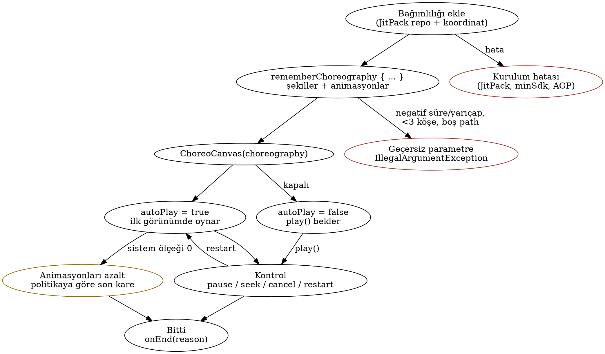
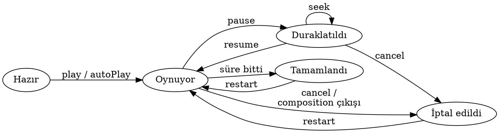

# Choreo İş Analizi (v2)

Tarih: 11.11.2026 · Hazırlayan: business-analyst ajanı · Durum: Nihai (v1 kararları uygulandı, açık karar yok)

## 1. Özet

- **Choreo**: Jetpack Compose Canvas üzerinde şekil çizen ve şekilleri tek satırla animate edip `sequence`/`parallel` ile koreografe eden açık kaynak Android kütüphanesi (`io.github.tugakca.choreo`, repo `tugakca/choreo`, Apache 2.0).
- Kullanıcı, kütüphaneyi ekleyen Android geliştiricisi; başarı ölçüsü "bağımlılığı ekle → ilk animasyonu gör" süresi.
- Fark: kontrol edilebilir tek zaman çizelgesi (play/pause/seek/cancel/restart), `drawOn`/`eraseOff` gibi hazır şekil efektleri, "animasyonları azalt" ayarına varsayılan uyum. En yakın rakip Koreography şekil çizmez, seek/pause sunmaz.
- API biçimi: `rememberChoreography { … }` ile kurulan state/kontrol nesnesi + `ChoreoCanvas` composable; `autoPlay = true` varsayılan.
- **v0.1.0 = yalnız Must maddeleri**; Should maddeleri v0.2. Hedef tarih yok.
- Dağıtım JitPack: `com.github.tugakca.choreo:choreo:v0.1.0` (çok modüllü repo koordinatı). Maven Central sonra.
- Platform: minSdk 23, saf Compose. Compose 1.12'nin tüketiciye compileSdk 37 / AGP 9.1.1 dayatması risk olarak açık.

## 2. Amaç ve kapsam

**Amaç:** "Bir şekli çiz, şu sırayla hareket ettir, sonra şunlar birlikte solsun" fikrini `Canvas` + `Animatable` + `PathMeasure` + coroutine kodu yazmadan, okunur bir DSL ile ifade ettirmek. İkincil değer: Senior Android portfolyosu (API tasarımı, yayıncılık, CI, ABI disiplini).

| Alternatif | Ne yapar | Choreo'ya göre boşluk |
|---|---|---|
| Compose yerleşik animasyon API'leri [K5] | Değer düzeyinde animasyon | Şekil modeli ve hazır koreografi yok, çizilme efekti yok |
| graphics-shapes 1.1.0 [K6] | Çokgen/yıldız geometrisi, morph | Animasyon yok; Choreo'nun **yapı taşı** (P3) |
| Lottie (Apache 2.0), Rive (MIT) [K7, K8] | Tasarımcı dosyası oynatır | Kod-öncelikli, dinamik şekil için uygun değil |
| Koreography (Apache 2.0) [K9] | `Animatable` için sequence/parallel DSL | Şekil çizmez, seek/pause yok, "early preview" |

| Sürüm | Kapsam |
|---|---|
| **v0.1.0** | Şekiller (daire, dikdörtgen, yuvarlak köşeli dikdörtgen, çizgi, çokgen, yıldız, `Path`, SVG path-data); stil (dolgu/kontur, renk, kalınlık, alpha, cap/join); moveTo, scaleTo, rotateTo, fadeTo, colorTo, drawOn, eraseOff, kısmi çizim; süre/easing/gecikme/tekrar; `sequence`/`parallel`; kontrol nesnesi; tek zaman çizelgesi; kesinti kuralı; reduced motion politikası; dp birimi; ABI kontrolü; testler; README + sample; JitPack + CI |
| **v0.2** | `stagger`, ileri-geri (yoyo) tekrar, kesikli çizgi (dash), oransal (0..1) birim, performans hedefi + 50 şekil stres demosu, diğer Should maddeleri |
| **Faz 2** | Morph, dokunma/sürükleme (parmakla çizim dahil), gradient, keyframe timeline, Compose Multiplatform, Maven Central |
| **Kapsam dışı** | View/Canvas desteği, SVG dosyası içe aktarma, ses senkronu |

## 3. Kullanıcılar ve hedefleri

| Kullanıcı | Hedefi | Beklentisi |
|---|---|---|
| Uygulama geliştiricisi (birincil) | Onboarding, boş durum, yükleme, başarı animasyonu | 5 dakikada kurulum, keşfedilebilir API, Compose'a yerli his |
| Tasarım odaklı geliştirici | Logo/illüstrasyon, çizilme efekti | Easing ve zamanlamada ince kontrol |
| Katkıcı | Hata düzeltme, yeni şekil/animasyon | Okunur kod, testler, yeşil CI |
| Tugrul (bakımcı) | Hızlı v0.1.0, sonra büyütme | Kırılmayan API, otomatik yayın |
| Son kullanıcı (dolaylı) | Akıcı, rahatsız etmeyen hareket | Animasyonları azalt ayarına uyum |

## 4. İş akışları

1. **Bağımlılık:** `settings.gradle.kts` içine `maven("https://jitpack.io")`, modüle `com.github.tugakca.choreo:choreo:<tag>`. İlk istekte JitPack derler; CI tag'de derlemeyi tetikleyip doğrular. minSdk < 23 veya eski AGP'de çakışma: README uyumluluk tablosu.
2. **Tanımlama:** `rememberChoreography { … }` içinde şekiller (dp birimi) ve animasyonlar. Tanım sırası = çizim sırası. Süre 0 geçerli (anında biter); negatif süre ve geçersiz geometri `IllegalArgumentException`.
3. **Çizim:** `ChoreoCanvas(choreography, modifier)`. Boyut 0 ise çizim yok, debug'da uyarı.
4. **Oynatma:** Varsayılan `autoPlay = true`; kapatılırsa `play()` beklenir. Animasyonları azalt açıksa (animator duration scale 0) varsayılan politika son kareye atlar; sonsuz döngüde statik kare.
5. **Kontrol:** play/pause/resume/cancel/restart/seek(0..1); durum ve ilerleme gözlemlenebilir; `onEnd(reason)` tamamlandı/iptal ayrımı yapar.
6. **Kesinti:** Aynı özelliğe yeni animasyon gelirse mevcut değerden devam eder, sıçrama olmaz.
7. **Yaşam döngüsü:** Recomposition sıfırlamaz (yalnız anahtar değişince yeniden kurulur); arka planda saat durur; **ekran döndürmede kaldığı yerden devam**; composition'dan çıkışta tüm işler iptal.

## 5. Gereklilikler

Ayrıntılı tablo Ek A'dadır (40 madde). Özet:

| Sürüm | Öncelik | Madde |
|---|---|---|
| v0.1.0 | Must | 31 madde: kurulum, şekiller, stil (cap/join dahil), 7 animasyon, koreografi, kontrol nesnesi, tek zaman çizelgesi, yaşam döngüsü, reduced motion, erişilebilirlik semantics, explicitApi + ABI, testler, CI, README, sample, lisans |
| v0.2 | Should | 7 madde: stagger, yoyo, dash, oransal birim, performans hedefi, README hareket uyarısı, bağımlılık lisans listesi |
| Sonra | Could | 2 madde: screenshot testleri, Dokka sitesi |

## 6. Regülasyon ve kısıtlar

| Kural | Bizden istediği | Kaynak |
|---|---|---|
| Apache License 2.0 | LICENSE ilk commit'te, telif satırı, dosya başlıkları | K15 |
| Bağımlılık lisansları | AndroidX, graphics-shapes, Kotlin: Apache 2.0, uyumlu; GPL eklenmez | K6, K15 |
| GitHub ToS D.5 | Kullanım hakkı LICENSE ile verilir | K17 |
| JitPack | `maven-publish`, `jitpack.yml` ile JDK 17+, grup `com.github.tugakca.choreo`; sample yayın dışı | K1, K2 |
| Maven Central (Faz 2) | Central Portal, `io.github.tugakca` namespace doğrulama, imza + sources + javadoc | K18 |
| Compose 1.12 | compileSdk 37 ve AGP 9.1.1+; tüketiciye de yansır | K11 |
| WCAG 2.2: 2.2.2, 2.3.1, 2.3.3, 1.1.1 | Duraklatılabilir hareket, yanıp sönen ön ayar yok, hareket kapatılabilir, metin alternatifi | K12-K14 |
| Android animasyon ölçeği | `MotionDurationScale`/sistem ölçeğine uyum | K3 |
| European Accessibility Act | Tüketici ürünlere uygulanır; erişilebilir varsayılanlar onlara yardımcı | K19 |
| Google Play Data safety | Choreo veri toplamaz, izin/ağ yok; README'de beyan | K16 |

## 7. Revizyon önerileri (kararlar)

| ID | Öneri | Karar |
|---|---|---|
| P1 | Kontrol nesnesi (play/pause/resume/cancel/restart/seek, durum, ilerleme, `onEnd(reason)`) | Onaylandı, v0.1.0 |
| P2 | Tek, deterministik zaman çizelgesi | Onaylandı, v0.1.0 |
| P3 | Çokgen/yıldız için graphics-shapes | Onaylandı, v0.1.0 |
| P4 | `eraseOff` ve kısmi çizim aralığı | Onaylandı, v0.1.0 |
| P5 | `stagger {}` | Onaylandı, v0.2 |
| P6 | İleri-geri (yoyo) tekrar | Onaylandı, v0.2 |
| P7 | Kesinti kuralı belgeli ve testli | Onaylandı, v0.1.0 |
| P8 | Serbest path = Compose `Path` + SVG path-data; parmakla çizim Faz 2 | Onaylandı, v0.1.0 |
| P9 | Kontur cap/join; dash | Kısmi: cap/join v0.1.0, dash v0.2 |
| P10 | Reduced motion politikası (varsayılan sisteme uy) | Onaylandı, v0.1.0 |
| P11 | Performans hedefi + 50 şekil stres demosu | Onaylandı, v0.2 |
| P12 | ABI kontrolü, `@ExperimentalChoreoApi`, SemVer 0.x, CHANGELOG | Onaylandı, v0.1.0 |
| P13 | JVM zaman çizelgesi + `mainClock` UI testleri | Onaylandı, v0.1.0 |
| P14 | Faz 2: View yerine Compose Multiplatform; çekirdek `android.*` bağımsız | Onaylandı |

## 8. Açık sorular ve riskler

**Kararlaştırılanlar (v1 soruları):** minSdk 23 · varsayılan birim dp, oransal birim v0.2 · API: `rememberChoreography { … }` + `ChoreoCanvas` · `autoPlay = true` · döndürmede kaldığı yerden · süre 0 anında, negatif hata · hedef tarih yok, v0.1.0 = Must · ad Choreo.

**Açık soru:** Yok. Teknik ayrıntılar (zaman çizelgesi modeli, saat kaynağı, döndürmede durum saklama yöntemi) developer aşamasında.

**Varsayımlar:** Tek bakımcı; README ve kod yorumları İngilizce; sample Play Store'a yayınlanmaz; kütüphane izin, ağ, veri toplama içermez.

| Risk | Azaltma |
|---|---|
| Compose 1.12 tüketiciye compileSdk 37 / AGP 9.1.1 dayatır | **Açık risk.** Developer aşamasında daha eski bir BOM ile tüketici şartını düşürmek değerlendirilecek; sonuç uyumluluk tablosuna yazılır |
| "İnce sarmalayıcı" algısı | P1, P2, P4, P10; README'de "ham Compose ile karşılaştırma" |
| Erken API kırılması | 0.x SemVer, ABI kontrolü, `@ExperimentalChoreoApi` |
| JitPack derleme kırılganlığı | `jitpack.yml`, tag'de CI doğrulaması, Faz 2'de Maven Central |
| Ad karışıklığı (`Choreographer`, Koreography) | Kabul edildi; README başlığında net tanım ve anahtar kelimeler |
| Kapsam kayması | v0.1.0 = yalnız Must |

## 9. Değerlendirilip alınmayanlar

- Reddedilen öneri yok.
- View/Canvas desteği yol haritasından çıkarıldı (P14): 2026'da talep düşük, yerine Compose Multiplatform.
- Ertelenenler (reddedilmedi): P5, P6, P11 ve dash v0.2'ye; gerekçe v0.1.0'ı yalnız Must ile hızlı yayınlamak.

## 10. Tasarıma devir

**Tasarımın konusu:** Kütüphanenin ekranı yok. Tasarım işi (1) `:sample` demo uygulaması, (2) README görselleri (GIF/hero), (3) geliştiriciye görünen API'nin okunurluğu (örnek kod blokları).

**Beklenen karakter:** Profesyonel geliştirici aracı / startup arası: sade, karanlık ve açık tema, animasyonların kendisini öne çıkaran nötr zemin, Material 3 tabanlı.

**Sample içeriği (v0.1.0):**

- Galeri: her şekil ve her animasyon için bir kart (canlı önizleme + kısa kod).
- Koreografi demoları: sequence, parallel, iç içe; drawOn/eraseOff ile logo çizimi.
- Playground: süre, easing, gecikme, tekrar seçimi; play/pause/seek kaydırıcısı/restart.
- Reduced motion demosu: politika seçimi ve sistem ayarı durumunun gösterimi.

**UI'yı kısıtlayan gereklilikler:**

- Her sürekli animasyonun görünür duraklat/durdur kontrolü olmalı (WCAG 2.2.2).
- Hızlı yanıp sönen demo yok (2.3.1); sistem animasyon ölçeği 0 iken demolar son kareyi gösterir.
- Dokunma hedefi en az 48dp, metin kontrastı en az 4.5:1; anlamlı çizimlerde `contentDescription`.
- README'de kurulum satırı ilk ekranda; uyumluluk tablosu (minSdk 23, compileSdk, AGP, Compose BOM).

**Tasarımcıya açık sorular:**

- Sample tek ekran galerisi mi, alt gezinmeli çok ekran mı?
- README GIF'leri sample'dan mı kaydedilecek, ayrı bir vitrin sahnesi mi gerekiyor?
- Choreo için logo/marka (drawOn ile çizilen bir logo vitrin olarak) isteniyor mu?

## Ek A. Ayrıntılı gereklilik tablosu

| ID | Gereklilik | Öncelik / sürüm |
|---|---|---|
| G01 | JitPack'ten tag ile kurulum; README'de `com.github.tugakca.choreo:choreo:<tag>` | Must / v0.1.0 |
| G02 | Saf Compose; çalışma zamanı bağımlılığı yalnız AndroidX Compose + graphics-shapes | Must / v0.1.0 |
| G03 | minSdk 23; compileSdk, Kotlin, Compose BOM, AGP README tablosunda | Must / v0.1.0 |
| G04 | Şekiller: daire, dikdörtgen, yuvarlak köşeli dikdörtgen, çizgi, çokgen, yıldız (graphics-shapes), Compose `Path`, SVG path-data | Must / v0.1.0 |
| G05 | Geçersiz parametrede açık mesajlı `IllegalArgumentException`; süre 0 geçerli (anında), negatif hata | Must / v0.1.0 |
| G06 | Stil: dolgu/kontur/ikisi, renk, kalınlık, alpha, cap/join | Must / v0.1.0 |
| G07 | Dönüşüm: konum, ölçek, dönme (pivot şekil merkezi), alpha; z-order = tanım sırası | Must / v0.1.0 |
| G08 | Animasyonlar: moveTo, scaleTo, rotateTo, fadeTo, colorTo, drawOn, eraseOff; kısmi çizim aralığı | Must / v0.1.0 |
| G09 | Süre, easing, gecikme, tekrar (n / sonsuz, baştan) | Must / v0.1.0 |
| G10 | `sequence {}` ve `parallel {}`, iç içe | Must / v0.1.0 |
| G11 | `stagger {}` | Should / v0.2 |
| G12 | İleri-geri (yoyo) tekrar | Should / v0.2 |
| G13 | Kesinti kuralı: mevcut değerden devam, sıçrama yok; belgeli ve testli | Must / v0.1.0 |
| G14 | Kontrol nesnesi: play, pause, resume, cancel, restart, seek(0..1); durum, ilerleme, `onEnd(reason)` | Must / v0.1.0 |
| G15 | Tek deterministik zaman çizelgesi | Must / v0.1.0 |
| G16 | API: `rememberChoreography { … }` + `ChoreoCanvas` | Must / v0.1.0 |
| G17 | `autoPlay = true` varsayılan, kapatılabilir | Must / v0.1.0 |
| G18 | Varsayılan birim dp | Must / v0.1.0 |
| G19 | Oransal (0..1) birim seçeneği | Should / v0.2 |
| G20 | Composition'dan çıkışta iptal, sızıntı yok | Must / v0.1.0 |
| G21 | Recomposition sıfırlamaz; yeniden kurulum yalnız anahtar değişince | Must / v0.1.0 |
| G22 | Ekran döndürmede kaldığı yerden devam | Must / v0.1.0 |
| G23 | Arka planda saat durur, dönüşte devam | Must / v0.1.0 |
| G24 | Sistem animasyon ölçeğine uyum; 0 iken son kare, sonsuz döngüde statik kare | Must / v0.1.0 |
| G25 | Reduced motion politikası: sisteme uy (varsayılan) / son kareye atla / yok say | Must / v0.1.0 |
| G26 | `ChoreoCanvas` için `contentDescription`/semantics; dekoratifse gizlenebilir | Must / v0.1.0 |
| G27 | README'de yanıp sönme ve uzun otomatik hareket uyarısı | Should / v0.2 |
| G28 | Kontur dash (kesikli çizgi) | Should / v0.2 |
| G29 | Performans: kareler recomposition tetiklemez; 50 şekil paralel animasyonda jank yok; stres demosu | Should / v0.2 |
| G30 | `explicitApi()`, tüm public API'de KDoc | Must / v0.1.0 |
| G31 | ABI dökümü + CI'da ABI kontrolü; `@ExperimentalChoreoApi` opt-in | Must / v0.1.0 |
| G32 | SemVer 0.x, CHANGELOG, GitHub Release notları | Must / v0.1.0 |
| G33 | JVM zaman çizelgesi testleri + Compose UI testleri (`mainClock`) | Must / v0.1.0 |
| G34 | GitHub Actions: PR'da build/test/lint/ABI; tag'de JitPack doğrulaması | Must / v0.1.0 |
| G35 | Screenshot testleri | Could |
| G36 | README: kurulum, hızlı başlangıç, GIF'ler, API özeti, uyumluluk, lisans | Must / v0.1.0 |
| G37 | Sample: galeri, koreografi demoları, playground, reduced motion demosu | Must / v0.1.0 |
| G38 | Dokka API sitesi | Could |
| G39 | Apache 2.0 LICENSE, dosya başlıkları; veri toplamaz/izin yok beyanı | Must / v0.1.0 |
| G40 | Üçüncü taraf bağımlılık ve lisans listesi README'de | Should / v0.2 |

## Ek B. Kaynaklar

- K1: https://docs.jitpack.io/android/
- K2: https://docs.jitpack.io/building
- K3: https://developer.android.com/reference/kotlin/androidx/compose/ui/MotionDurationScale
- K4: https://kotlinlang.org/docs/gradle-binary-compatibility-validation.html
- K5: https://developer.android.com/jetpack/androidx/releases/compose-animation
- K6: https://developer.android.com/jetpack/androidx/releases/graphics
- K7: https://github.com/airbnb/lottie-android
- K8: https://github.com/rive-app/rive-android
- K9: https://github.com/sagar-viradiya/koreography
- K11: https://android-developers.googleblog.com/2026/08/jetpack-compose-august-2026-release.html
- K12: https://www.w3.org/WAI/WCAG22/Understanding/pause-stop-hide.html
- K13: https://www.w3.org/WAI/WCAG22/Understanding/non-text-content.html
- K14: https://www.w3.org/WAI/WCAG22/Understanding/three-flashes-or-below-threshold.html
- K15: https://www.apache.org/licenses/LICENSE-2.0
- K16: https://support.google.com/googleplay/android-developer/answer/10787469
- K17: https://docs.github.com/en/site-policy/github-terms/github-terms-of-service
- K18: https://central.sonatype.org/news/20250326_ossrh_sunset/
- K19: https://eur-lex.europa.eu/eli/dir/2019/882/oj
